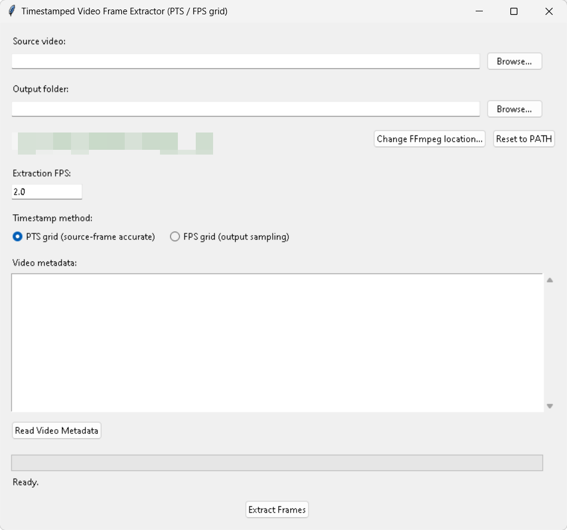

# Timestamped Video Frame Extractor

A Python/Tkinter tool that extracts JPEG frames from video and timestamps each image (filename, EXIF, and optionally Windows file times) using the video's recording-start metadata.

The unified application supports two extraction algorithms, selectable in the GUI:

| Algorithm | Timestamp is | Use when |
|---|---|---|
| **Source-frame PTS** | PTS of the selected source frame | Source-frame timing matters |
| **FPS grid** | Requested output sampling time | A regular sampling timeline is sufficient |

The Python script runs directly in a Python environment. The released standalone Windows executable combines both algorithms and does not require a separate Python installation.

## Timestamps

`recording_start` comes from video metadata (Apple QuickTime creation date preferred, otherwise generic creation time). It is assumed to represent the time of the first frame; this is not independently verified. If no usable creation metadata is available, extraction cannot establish the recording-start timestamp and there is no fallback to filesystem time.

**Source-frame PTS:** `frame_time = recording_start + (selected_pts - first_selected_pts)`. FPS defines the sampling grid, and each grid point is matched to the nearest source frame.

**FPS grid:** `sampling_time = recording_start + frame_index / fps`, with `frame_index` starting at 0. FFmpeg's `fps` filter may duplicate frames; duplicates receive distinct sampling timestamps. The timestamp is the requested sampling time, not necessarily the source frame's PTS.

The same timestamp is used for the filename, EXIF, and optional Windows file times. Windows file-time synchronization is off by default and Windows-only.

Filenames use `YYYYMMDD_HHMMSS_fff_NNNNNN.jpg`, where `NNNNNN` is the 1-based output sequence number.

## Requirements

**Run the Python script**
- Python 3
- FFmpeg/FFprobe in `PATH`
- `pip install ffmpeg-python piexif`
- Tkinter; on Linux, it may need to be installed separately

**Run the standalone executable**
- Windows
- No separate Python installation required
- Runs silently without opening flashing console windows
- FFmpeg and FFprobe must be available. The application auto-detects them in the system `PATH`. If not found, a **Locate FFmpeg folder...** button allows you to manually point to the directory containing `ffmpeg.exe` and `ffprobe.exe`. The selected path is saved for future sessions.

Tested with: Python 3.11, FFmpeg 7.x, Windows 11.

## Usage

**Python**

~~~bash
python extractor_ui_unified.py
~~~

**Standalone Windows executable**

Launch the released `.exe` file.

At startup, the application checks FFmpeg availability and displays the detected version and absolute path in the UI. If FFmpeg is unavailable, the Extract and Read Metadata buttons are disabled until you locate the executables. You can reset the application to use the system `PATH` at any time via the **Reset to PATH** button.

Select a video, set the FPS sampling rate, choose **Source-frame PTS** or **FPS grid**, then click **Extract Frames**. JPEGs and the corresponding diagnostic log files are written to the output folder. Existing files with the same generated name are overwritten.

## Diagnostics

The unified application writes diagnostic logs according to the selected algorithm.

**Source-frame PTS**
- `ffmpeg_last_run.log` — FFmpeg command, return code, stdout/stderr.
- `extraction_benchmark.log` — timing and frame-selection diagnostics.

Selection error is the temporal difference between the selected source-frame PTS and its requested sampling position. JPEG-size diagnostics describe the generated JPEG-size distribution and are observational only; neither diagnostic affects frame selection or output.

**FPS grid**
- `fps_extraction_log.log` — extraction parameters, frame counts, timings, FFmpeg diagnostics, and the output sampling-time map.

## Settings

If you manually override the FFmpeg location, the application stores this path in:
`%APPDATA%\TimestampedVideoFrameExtractor\settings.json`

## Limitations

- The packet-PTS-to-FFmpeg-frame mapping has been empirically tested on the target iPhone MOV workflow. It is not guaranteed for other codecs, containers, or timestamp structures, and a mapping mismatch is not independently detected.
- DTS fallback is not equivalent to PTS when frames are reordered.
- The FPS-grid timestamp is a requested sampling time, not a measured source-frame time.
